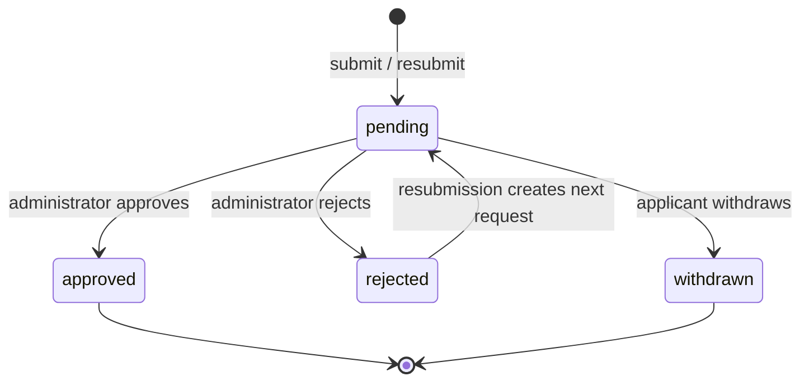
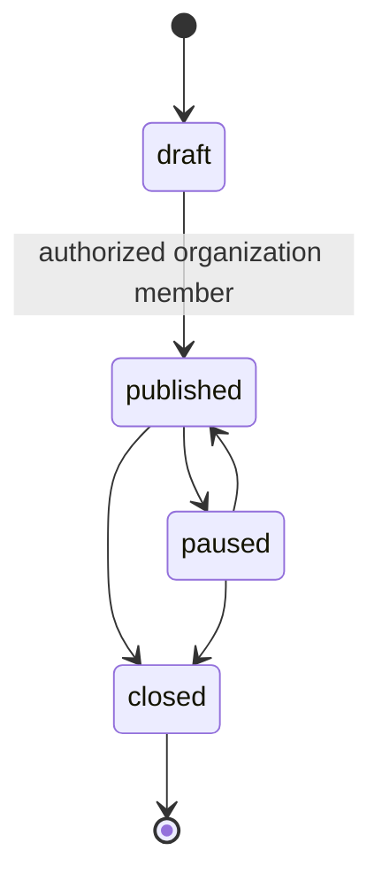

# Arcanix entity relationship design

> Review artifact only. It describes the proposed schema; no database object has been created.

```mermaid
erDiagram
  AUTH_USERS ||--|| PROFILES : owns
  PROFILES ||--o{ USER_ROLES : has
  PROFILES ||--|| USER_SETTINGS : configures
  PROFILES ||--o| PLAYER_DETAILS : extends
  PROFILES ||--o{ PLAYER_SKILLS : lists
  PROFILES ||--o{ PLAYER_ACHIEVEMENTS : records
  PROFILES ||--o{ PLAYER_EXPERIENCE : records
  GAMES ||--o{ PLAYER_DETAILS : primary_game
  GAMES ||--o{ PLAYER_SKILLS : game
  GAMES ||--o{ PLAYER_ACHIEVEMENTS : game
  GAMES ||--o{ PLAYER_EXPERIENCE : game

  PROFILES ||--o{ ORGANIZATIONS : creates
  ORGANIZATIONS ||--o{ ORGANIZATION_MEMBERS : has
  PROFILES ||--o{ ORGANIZATION_MEMBERS : joins
  ORGANIZATIONS ||--o{ OPPORTUNITIES : publishes
  PROFILES ||--o{ OPPORTUNITIES : creates
  GAMES ||--o{ OPPORTUNITIES : scopes

  PROFILES ||--o{ VERIFICATION_REQUESTS : submits
  PROFILES ||--o{ VERIFICATION_REQUESTS : subject_profile
  ORGANIZATIONS ||--o{ VERIFICATION_REQUESTS : subject_organization
  VERIFICATION_REQUESTS ||--o{ VERIFICATION_HISTORY : logs
  VERIFICATION_REQUESTS ||--o{ VERIFICATION_DOCUMENTS : contains
  VERIFICATION_REQUESTS ||--o{ VERIFICATION_REVIEW_NOTES : internal_notes

  PROFILES ||--o{ POSTS : authors
  ORGANIZATIONS ||--o{ POSTS : scopes
  POSTS ||--o{ POST_MEDIA : contains
  POSTS ||--o{ LIKES : receives
  PROFILES ||--o{ LIKES : creates
  POSTS ||--o{ COMMENTS : contains
  PROFILES ||--o{ COMMENTS : authors
  COMMENTS ||--o{ COMMENTS : replies_to
  PROFILES ||--o{ FOLLOWS : follows
  PROFILES ||--o{ FOLLOWS : followed_by
  PROFILES ||--o{ CONNECTIONS : requests
  PROFILES ||--o{ CONNECTIONS : receives
  CONNECTIONS ||--o{ CONNECTION_EVENTS : audits
  PROFILES ||--o{ SAVED_POSTS : saves
  POSTS ||--o{ SAVED_POSTS : is_saved
  PROFILES ||--o{ PROFILE_MEDIA : owns

  OPPORTUNITIES ||--o{ APPLICATIONS : receives
  PROFILES ||--o{ APPLICATIONS : submits
  APPLICATIONS ||--o{ APPLICATION_REVIEWS : internal_reviews
  PROFILES ||--o{ NOTIFICATIONS : receives
  PROFILES ||--o{ REPORTS : files
  POSTS ||--o{ REPORTS : subject
  COMMENTS ||--o{ REPORTS : subject
  OPPORTUNITIES ||--o{ REPORTS : subject
  REPORTS ||--o{ REPORT_REVIEWS : internal_reviews
  PROFILES ||--o{ ADMIN_ACTIONS : performs
```

## Key cardinalities and invariants

| Area | Rule |
|---|---|
| Identity | `profiles.id` is both its PK and an FK to `auth.users.id`; an Auth user has at most one profile. |
| Roles | One profile can hold `player`, `recruiter`, and/or `admin`; only one active row per role exists. |
| Organization | A profile can belong to many organizations; an organization has many members. Every active organization must retain one active `owner`. |
| Verification | A request targets exactly one subject: a player/recruiter profile or an organization. A request has many immutable history entries and private documents. |
| Player identity | `player_details` is one-to-one; skills, achievements, experience, and media are one-to-many. |
| Social | A post has media, likes, comments, and saves. A follow is directional; a connection is an unordered relationship request with one canonical pair. |
| Recruitment | An opportunity belongs to exactly one organization; an applicant can create at most one application per opportunity. |
| Moderation | Reports target exactly one supported resource. Admin actions retain the actor and one optional target. |

## Task 1B correction relationships

- `user_roles` is a **grant history**, not a fixed `(user_id, role)` join. A profile can have many historical grants for one role, but only one active grant through a partial unique index.
- `verification_review_notes`, `application_reviews`, and `report_reviews` isolate administrator/recruiter-only notes from applicant/reporter-visible records; no sensitive field shares a row with a client-readable projection.
- `connection_events` records request, decline, cancellation, re-open, block, and unblock events. `connections` remains one canonical current relationship per unordered profile pair.
- Profile child data and `profile_media` are governed by the profile’s effective visibility; `is_discoverable` is a directory filter, not a direct-read permission.

## State transitions

## Data ownership map

- **Profile-owned:** profile, settings, player data, profile media, personal posts, comments, follows, connections, saved posts, applications, report submissions.
- **Organization-owned:** organization metadata, authorized membership records, opportunities, organization posts.
- **Administrator-owned:** role grants, verification decisions/history, report resolution, suspension and audit actions.
- **System-owned:** games catalogue, notifications created by backend events, timestamps, derived verification status.

The `verification_documents` and Storage objects are deliberately absent from public discovery relationships. Their relationship starts only at a verification request, and RLS permits the applicant or an authorized administrator.
